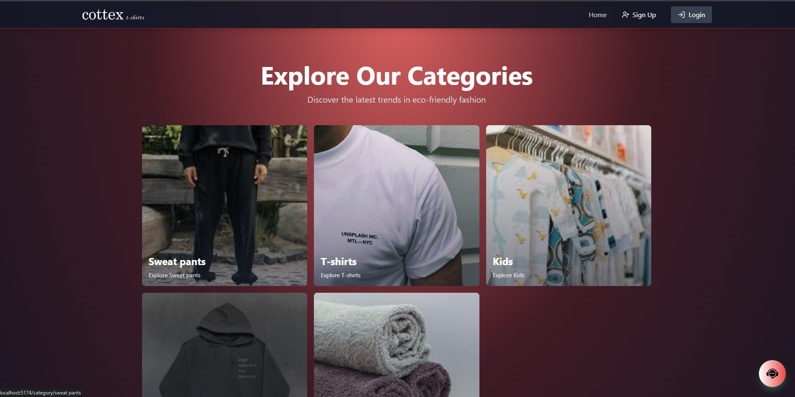
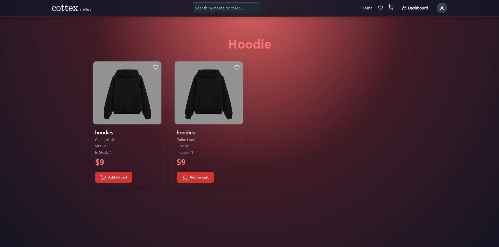
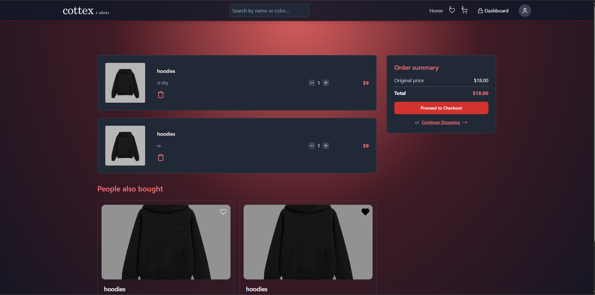
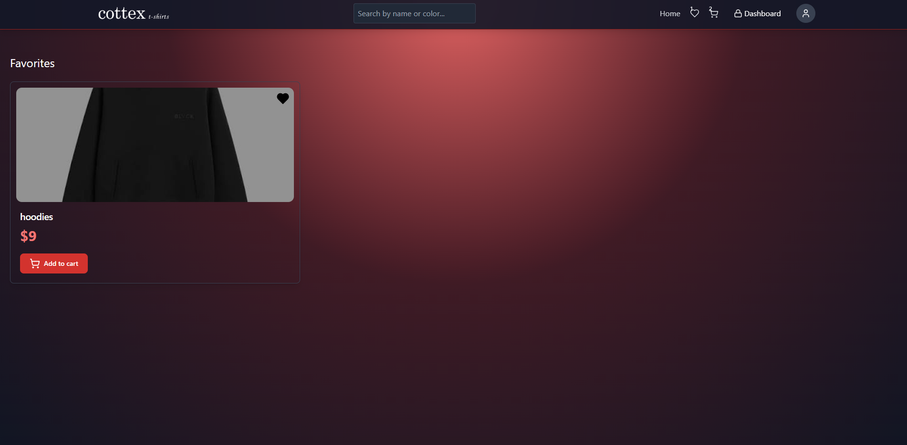
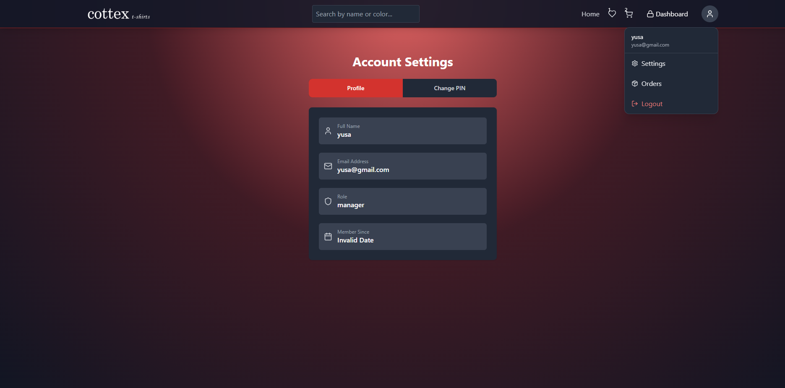
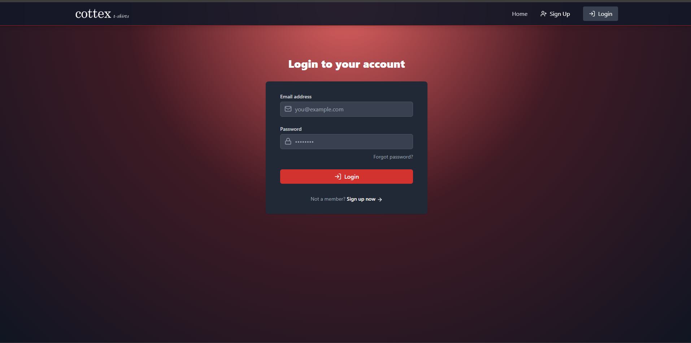
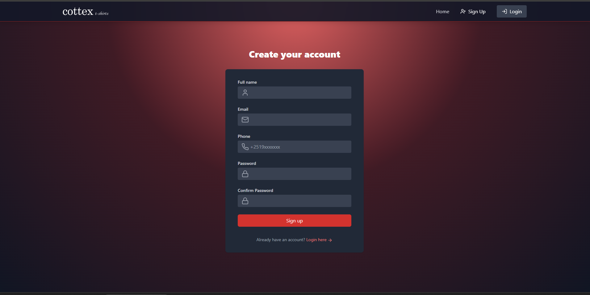
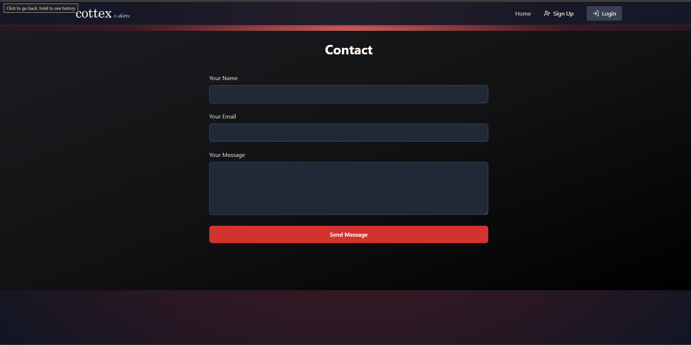

# Cottex: MERN E-Commerce Store

<p align="center">
  
</p>

A full-stack clothing store built with the MERN stack. Customers browse and favorite products, order them and pay online. Managers add products and admins manage users and orders.

> Based on a MERN e-commerce tutorial. Extended with orders, favorites, local payment options and role-based access.

## Features

- Authentication: signup, login, JWT access and refresh tokens, forgot-password with a temporary PIN sent by email
- Role-based access: customer, manager and admin
- Product catalog with categories (T-shirts, Sweat pants, Kids, Hoodies), search and featured products
- Shopping cart and favorites
- Orders: place orders and track them (customer view and admin orders tab)
- Online payments with Chapa and local bank options
- Admin dashboard: users, orders, products and analytics
- Image uploads with Cloudinary
- Redis (Upstash) caching for featured products and tokens
- Email notifications with Nodemailer

## Screenshots

| | |
|---|---|
|  |  |
| **Products** | **Cart** |
|  |  |
| **Favorites** | **Account settings** |
|  |  |
| **Login** | **Sign up** |



## Tech Stack

**Frontend:** React (Vite), Tailwind CSS, Zustand, Axios
**Backend:** Node.js, Express, MongoDB (Mongoose)
**Services:** MongoDB Atlas, Upstash Redis, Cloudinary, Chapa, Nodemailer

## Getting Started

### 1. Install

```bash
git clone https://github.com/codewithyusa/ecommerce.git
cd ecommerce
npm install
cd frontend
npm install
```

### 2. Environment variables

Create a `.env` file in the project root:

```env
PORT=5000
MONGO_URI=
UPSTASH_REDIS_REST_URL=
UPSTASH_REDIS_REST_TOKEN=
ACCESS_TOKEN_SECRET=
REFRESH_TOKEN_SECRET=
CLOUDINARY_CLOUD_NAME=
CLOUDINARY_API_KEY=
CLOUDINARY_API_SECRET=
CHAPA_AUTH=
CHAPA_URL=https://api.chapa.co/v1/transaction/initialize
BASE_URL=http://localhost:5000
FRONTEND_URL=http://localhost:5173
EMAIL_USER=
EMAIL_PASS=
```

Never commit your `.env` file.

### 3. Run

```bash
# backend (project root)
npm run dev

# frontend (second terminal)
cd frontend
npm run dev
```

The frontend runs at `http://localhost:5173` and the API at `http://localhost:5000`.

## Roles

| Role | Can do |
|---|---|
| customer | browse, cart, favorites, orders |
| manager | create and manage products |
| admin | manage users, orders and analytics |

## Author

**Yusuf Umer**: [GitHub](https://github.com/codewithyusa) · [LinkedIn](https://www.linkedin.com/in/yusuf-umer-868b0735a)